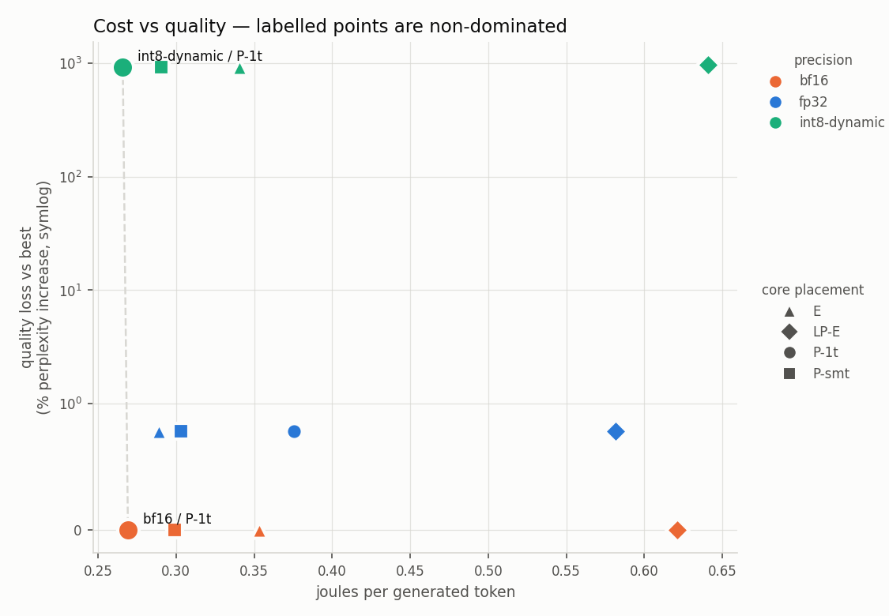

# Where do the joules go?

**Energy, latency and quality of LLM inference across the three CPU power islands
of an Intel Core Ultra 7 155H, measured with RAPL counters rather than estimated.**

Every deployment decision for on-device inference trades energy against latency
against output quality, and in practice people guess. For datacenter GPUs there is
at least published data. For the heterogeneous consumer SoCs that actually run
local models there is very little, and almost none of it with ground-truth energy.

So: **for a fixed quality budget, which numeric precision and which core island
gives the lowest joules per generated token — and how much quality must you give
up to halve the energy?**

## What this measures

| Axis | Levels |
| --- | --- |
| Precision | `fp32` · `bf16` · `int8-dynamic` (PyTorch dynamic quantization of Linear layers) |
| Core island | `P-1t` (6 P-cores, one thread each) · `P-smt` (all 12 P threads) · `E` (8 E-cores) · `LP-E` (2 low-power cores) · `all` |
| Thread count | sweepable within a placement |
| Engine | `cpu` implemented · `igpu` and `npu` stubbed, see below |

Recorded per run: RAPL joules (package / core / uncore), **prefill and decode timed
separately**, per-step decode latency, **KV cache bytes at every decode step**, peak
RSS, parameter bytes, perplexity, and a needle-in-context retrieval probe.

Prefill and decode are separated because they have completely different cost
structure — prefill is compute-bound over the whole prompt, decode is memory-bound
and emits one token at a time — so a single wall-clock number per request hides the
thing an energy study is about.

## Results

**[`FINDINGS.md`](FINDINGS.md)** — the claims, written by hand.
Generated tables and plots live under `runs/<model>/`.



Headline, from Qwen2.5-0.5B-Instruct across 12 configurations with joules measured:

| | J/token | tok/s | perplexity | needle |
| --- | --- | --- | --- | --- |
| **bf16 / P-cores, 1 thread each** | **0.269** | 17.7 | 11.091 | 3/3 |
| bf16 / E-cores | 0.353 | 14.4 | 11.091 | 3/3 |
| bf16 / LP-E cores | 0.621 | 7.4 | 11.091 | 3/3 |
| fp32 / P-cores | 0.376 | 9.5 | 11.178 | 3/3 |
| int8-dynamic / P-cores | 0.266 | 36.3 | **113.763** | **0/3** |

Three things fall out:

1. **The efficiency cores are not energy-efficient here.** LP-E costs 2.3× the
   joules per token of the performance cores, and E-cores 31% more. Low power
   draw loses to shorter runtime — race-to-idle wins even on a memory-bound
   workload. A throughput-only study gets this backwards.
2. **bf16 strictly dominates fp32**: 28% less energy, 86% more throughput, and
   marginally better perplexity. No tradeoff at all.
3. **int8-dynamic is 2× faster and unusable** — perplexity ×10, needle retrieval
   gone — for a 1.2% energy saving. The lesson is about quantization
   *granularity*, not bit width: per-tensor scaling is the wrong scheme.

## Install

```bash
pip install -r requirements.txt
```

Nothing needs to be built and no GPU is required. `torch` will pull a CUDA build
by default; for CPU only use
`pip install torch --index-url https://download.pytorch.org/whl/cpu`.

## Quick start

```bash
make test                              # 31 unit tests, no model needed
make check                             # islands + RAPL status
python3 topology.py                    # what islands does this machine have?
python3 energy.py --selftest           # can we read RAPL?
make sweep                             # full sweep, small model
make sweep-big                         # full sweep, Qwen2.5-0.5B-Instruct
```

`python3 chat.py --precision bf16` talks to a model interactively and prints the
same per-request instrumentation the runner records — useful for feeling what a
10x perplexity difference actually looks like.

## Energy measurement setup

RAPL counters are root-only by default — a mitigation for CVE-2020-8694, where
power traces were used to recover AES keys. Grant read access:

```bash
# this session only -- note the /sys/devices path, NOT /sys/class
sudo chmod -R a+r /sys/devices/virtual/powercap/

# permanent
echo 'SUBSYSTEM=="powercap", ACTION=="add", RUN+="/bin/chmod -R a+r /sys/devices/virtual/powercap"' \
  | sudo tee /etc/udev/rules.d/99-rapl-readable.rules
sudo udevadm control --reload
```

**The path matters.** `/sys/class/powercap/*` are symlinks into `/sys/devices`,
and `chmod -R` does not follow symlinks — chmod'ing the `/sys/class` path
appears to succeed and changes nothing. `energy.py --selftest` prints the
resolved path if access is denied.

**Without this the harness still runs** — timing, memory, KV cache and quality are
all collected, energy is recorded as `null`, and both `analyze.py` and `RESULTS.md`
state plainly that the cost axis fell back to seconds per token. Nothing is
estimated and then presented as measured.

## Measurement discipline

A laptop is a hostile place to measure energy, and ignoring that is how this kind
of result gets dismissed. The harness enforces:

- **Idle baseline subtracted.** Measured once per run; at these batch sizes idle
  draw is a large fraction of the total, so gross joules would mostly measure the
  machine being switched on. Both gross and net are recorded.
- **Thermal soak.** A warmup generation per configuration, discarded. The first run
  after load sees cold caches and a full turbo budget; the throttled steady state
  is the honest number.
- **Repeats with IQR.** Median over N runs, interquartile range reported. Timing
  distributions here are right-skewed — a background process adds a long tail and
  nothing pulls the other way — so median beats mean, and a single number is not a
  measurement.
- **Fixed inputs.** Same prompts, same seed, same corpus for every configuration.
- **Affinity restored** after each configuration, so placements cannot leak into one
  another.

## Layout

| File | Role |
| --- | --- |
| `energy.py` | RAPL domain discovery, wraparound-safe joule accounting, idle baseline |
| `topology.py` | Frequency-based island classification, SMT handling, affinity pinning |
| `backends.py` | Backend interface; PyTorch CPU implementation with manual decode loop |
| `quality.py` | Perplexity + needle-in-context probe at several depths |
| `runner.py` | Configuration matrix, measurement loop, `results.jsonl` |
| `analyze.py` | Median/IQR, Pareto frontier, plots, `RESULTS.md` |
| `corpus.txt` | Fixed perplexity corpus: 12 kB of *Alice in Wonderland*, public domain, via Project Gutenberg. **Do not edit** — changing it invalidates every perplexity number |
| `chat.py` | Interactive prompt against one configuration |
| `tests/` | 28 unit tests for the logic that would silently corrupt results |

Island classification uses `cpuinfo_max_freq` rather than a hardcoded CPU model, so
it degrades sensibly elsewhere: a homogeneous CPU yields a single tier. Meteor Lake
reports two P-core turbo bins (4.8 and 4.5 GHz) which are the same core type, so
tiers within 10% of each other are merged rather than reported as separate islands.

## Not yet implemented

The iGPU and NPU are present on this machine (`/dev/dri/renderD128`, and
`/dev/accel/accel0` with `intel_vpu` loaded) but need separate toolchains — oneAPI
SYCL and OpenVINO GenAI respectively. They are declared in `backends.py` as stubs
that raise `NotImplementedError` with instructions, and a unit test asserts they
cannot silently pretend to work. Adding them requires no change to the runner.

## Limitations

- One machine, one SoC generation. Nothing here generalises beyond it.
- 15 GB RAM caps model size.
- The RAPL package domain includes the iGPU on integrated parts, so CPU and iGPU
  energy cannot be fully separated within a single run.
- `int8-dynamic` is per-tensor quantization of Linear layers only. It is not
  comparable to GGUF K-quants or GPTQ, which use finer-grained scales — a point the
  results make rather vividly.
- Perplexity is only ever compared between precisions of the *same* model on the
  *same* corpus with the *same* tokenizer. Cross-model perplexity comparison would
  be meaningless and the runner never does it.

## Why

Written by someone who spent a year choosing quantization precision empirically,
validating afterwards, and never once measuring energy. This is the dataset I
wanted and could not find.
