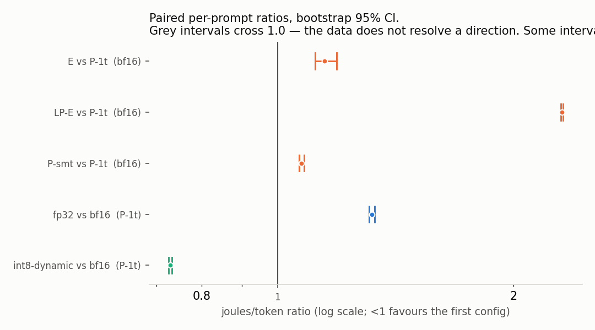

# ⚡ TokenWatt

> **Energy, latency, and quality of LLM inference across the three CPU power islands of an Intel Core Ultra 7 155H, measured with Intel RAPL counters rather than estimated.**

<p align="center">


[](https://doi.org/10.5281/zenodo.23243516)


</p>

---

# At a Glance

**On an Intel Core Ultra 7 155H, the low-power "efficiency" cores used 2.31× more energy per generated token than the performance cores** (95% CI [2.301, 2.314]) when running a small language model. They drew the same power and ran 2.3× slower. The energy cost is simply the extra time spent running: race-to-idle.

| Finding | Number |
|---|---|
| LP-E vs P-core energy per token (BF16, Qwen2.5-0.5B) | **2.31×** more on LP-E |
| Package power across every FP32/BF16 placement | **14.00 W** (differs by < 0.1%) |
| Energy ratio vs inverse throughput ratio | matches within **1.1%** |
| BF16 vs FP32 on P-cores | **1.32×** less energy, same quality |
| INT8 dynamic quantization | **27% cheaper**, but perplexity 12.4 → **110** and needle retrieval 3/3 → **0/3** |

<p align="center">
  
</p>

**Dataset:** 240 RAPL measurements = 12 configurations (3 precisions × 4 core placements) × 4 fixed prompts × 5 true repeats, 256 generated tokens each, idle baseline subtracted. Every discarded run is kept under `runs/discarded/` with the reason it was rejected.

**Reproduce:**

```bash
make test          # 64 unit tests, no model download needed
make check         # CPU topology, power islands and RAPL access
make sweep-big     # re-measures the full 240-row Qwen2.5-0.5B dataset
```

**Cite:** use the concept DOI [10.5281/zenodo.23243516](https://doi.org/10.5281/zenodo.23243516), which always resolves to the latest version. `CITATION.cff` gives the full citation (GitHub's "Cite this repository" button reads it).

---

# Table of Contents

- [At a Glance](#at-a-glance)
- [Overview](#overview)
- [Research Question](#research-question)
- [Key Features](#key-features)
- [Benchmark Matrix](#benchmark-matrix)
- [Metrics Collected](#metrics-collected)
- [Measurement Methodology](#measurement-methodology)
- [Results](#results)
- [Repository Structure](#repository-structure)
- [Installation](#installation)
- [Quick Start](#quick-start)
- [Energy Measurement Setup](#energy-measurement-setup)
- [Measurement Discipline](#measurement-discipline)
- [Future Work](#future-work)
- [Limitations](#limitations)
- [Why](#why)

---

# Overview

Every deployment decision for on-device LLM inference is ultimately a tradeoff between:

- **Energy consumption**
- **Latency**
- **Output quality**

Despite this, most deployment decisions are still made empirically. While there is a growing body of published work for datacenter GPU inference, there is comparatively little data for heterogeneous consumer processors—and almost none that measures **ground-truth energy directly** instead of estimating it.

This project measures the relationship between **energy**, **performance**, and **quality** during local LLM inference on an **Intel Core Ultra 7 155H** using **Intel RAPL hardware counters**.

Unlike many benchmarking projects, this repository does **not estimate power usage** from CPU utilization or TDP. Every reported energy value comes directly from Intel's hardware energy counters.

---

# Research Question

For a fixed quality budget,

> **Which numeric precision and which CPU power island produces the lowest energy per generated token?**

and

> **How much model quality must be sacrificed to reduce energy consumption?**

Instead of optimizing only for latency or throughput, this project evaluates the complete tradeoff between

- Energy
- Throughput
- Latency
- Model Quality

allowing deployment decisions to be made using measured data rather than intuition.

---

# Key Features

## Ground-truth Energy Measurement

- Intel RAPL hardware counters
- Package, core and uncore energy
- Idle baseline subtraction
- Wraparound-safe accounting

---

## Hardware-aware Benchmarking

- Performance cores
- Efficiency cores
- Low-power efficiency cores
- SMT vs non-SMT execution
- CPU affinity pinning

---

## Performance Profiling

- Prefill latency
- Decode latency
- Per-token decode latency
- Tokens/sec
- Peak RSS
- Parameter memory
- KV cache growth

---

## Quality Evaluation

- Perplexity
- Needle-in-a-Haystack retrieval
- Fixed evaluation corpus
- Fixed prompts
- Fixed random seed

---

## Statistical Analysis

- Multiple repeats
- Median aggregation
- Interquartile Range (IQR)
- Pareto frontier generation

---

# Benchmark Matrix

The benchmark sweeps multiple hardware and inference configurations.

| Axis | Levels |
|------|---------|
| **Precision** | `fp32`, `bf16`, `int8-dynamic` |
| **CPU Placement** | `P-1t`, `P-smt`, `E`, `LP-E`, `all` |
| **Thread Count** | Sweepable within each placement |
| **Inference Engine** | `cpu` implemented, `igpu` and `npu` stubbed |

### Precision Modes

- **FP32** – Standard floating-point inference
- **BF16** – Brain Floating Point (reduced precision)
- **INT8 Dynamic** – PyTorch dynamic quantization of Linear layers

### CPU Placements

| Placement | Description |
|-----------|-------------|
| **P-1t** | Six Performance cores, one thread per core |
| **P-smt** | All twelve Performance threads (SMT enabled) |
| **E** | Eight Efficiency cores |
| **LP-E** | Two Low-Power Efficiency cores |
| **all** | Entire CPU |

---

# Metrics Collected

Every benchmark run records the following measurements.

## Energy

- Package joules
- Core joules
- Uncore joules
- Gross energy
- Net energy (idle baseline removed)
- Joules per generated token

---

## Performance

- Prefill latency
- Decode latency
- Per-token decode latency
- Tokens per second
- Total inference time

---

## Memory

- Peak RSS
- Parameter bytes
- KV cache size
- KV cache growth per decode step

---

## Quality

- Perplexity
- Needle-in-context retrieval success

---

# Why Prefill and Decode are Measured Separately

LLM inference consists of two fundamentally different computational phases.

```
Prompt
   │
   ▼
Prefill
   │
   ▼
KV Cache
   │
   ▼
Decode
   │
Generated Tokens
```

### Prefill

The model processes the **entire prompt simultaneously**.

Characteristics:

- Compute-bound
- Matrix multiplication heavy
- Highly parallel
- Large tensor operations

---

### Decode

The model generates **one token at a time** using the existing KV cache.

Characteristics:

- Memory-bound
- Sequential
- Latency-sensitive
- Reuses cached attention states

Because these phases have entirely different performance characteristics, reporting only a single wall-clock inference time hides where time and energy are actually spent.

This project therefore measures:

- Prefill latency
- Decode latency
- Per-token decode latency

independently.

---

# Measurement Methodology

The benchmarking pipeline is designed to measure inference consistently across multiple hardware configurations.

```
                  Configuration
                        │
                        ▼
               CPU Affinity Pinning
                        │
                        ▼
            Warm-up Until Settled (<5%)
                        │
                        ▼
                Benchmark Repetitions
                        │
        ┌───────────────┼────────────────┐
        │               │                │
        ▼               ▼                ▼
     Energy         Performance       Quality
        │               │                │
        └───────────────┼────────────────┘
                        ▼
               Statistical Analysis
                        │
                        ▼
                 Pareto Frontier
```

Each benchmark configuration records

- Energy
- Latency
- Throughput
- Memory
- KV cache growth
- Quality metrics

using identical prompts, seeds and evaluation corpus.

**Warm-up is not a single generation.** Each configuration is warmed at the full
measurement length, repeatedly, until two consecutive warm-ups agree within 5% —
two to five rounds were needed here. A single 8-token warm-up left throughput
still climbing when trials began, producing a **+20.5% drift inside one
configuration** at 256 tokens, and because the drift size varied by
configuration it did not cancel between them. It had inverted the BF16-vs-FP32
result. See `runs/warmup-ablation/`.

**Repeats are repeats.** Each configuration is measured on 4 fixed prompts with
5 true repeats each. Ratios are formed *within* a prompt and then aggregated,
which cancels prompt-to-prompt variation, and reported as a geometric mean with
a bootstrap 95% interval. No direction is claimed where an interval spans 1.0.

---

# Results

The complete experimental findings are summarized in **`FINDINGS.md`**.

Generated plots, tables and raw benchmark outputs are stored under:

```
runs/<model>/
```

The primary dataset is based on

> **Qwen2.5-0.5B-Instruct**

evaluated across **12 hardware configurations**, with **4 fixed prompts x 5 true repeats = 20 measurements per configuration** (240 rows), **256 generated tokens each**, using measured Intel RAPL energy.

## Headline Results

| Configuration | J/token | tok/s | Gross W | Net W | Perplexity | Needle |
|---------------|---------|--------|---------|-------|------------|---------|
| **BF16 / P-cores (1 thread/core)** | **0.1758** | **16.1** | **14.00** | **2.77** | **12.427** | **3/3** |
| BF16 / P-cores (SMT) | 0.1878 | 15.1 | 14.01 | 2.77 | 12.427 | 3/3 |
| BF16 / E-cores | 0.1987 | 14.4 | 14.01 | 2.78 | 12.427 | 3/3 |
| BF16 / LP-E cores | 0.4053 | 7.0 | 14.00 | 2.77 | 12.427 | 3/3 |
| FP32 / P-cores (1 thread/core) | 0.2313 | 12.0 | 14.00 | 2.77 | 12.449 | 3/3 |
| INT8 Dynamic / P-cores | 0.1281 | 27.7 | 14.78 | 3.55 | **109.953** | **0/3** |

The measurements lead to four primary observations discussed below.

---

# Key Finding 1

## Efficiency cores were **not** the most energy-efficient.

LP-E cores required **2.306× more joules per generated token** than the Performance cores, with a bootstrap 95% interval of **[2.301, 2.314]**.

Although LP-E cores consumed nearly the same power as P-cores, they produced substantially fewer tokens per second.

| Placement | Gross Power | Throughput |
|------------|-------------|------------|
| P-1t | 14.00 W | 16.1 tok/s |
| LP-E | 14.00 W | 7.0 tok/s |

Package power is **14.00 W for every FP32 and BF16 configuration measured**, across islands spanning 7.0 to 16.1 tok/s — against a 40 W platform limit, so this is not a power cap. Power differs by under **0.1%** while throughput differs by **2.3×**.

Because power is constant, energy per token reduces to duration, and that is a testable prediction. The measured energy ratios match the inverse of the independently measured throughput ratios to within **1.1%** in every memory-bound comparison.

The increased energy cost therefore came almost entirely from **longer execution time**, not higher instantaneous power.

This is a direct example of **race-to-idle**:

> Finishing the workload sooner consumed less total energy than executing slowly at nearly the same power.

A throughput-only benchmark would reach the same ranking here only by coincidence and would not explain *why* the ranking occurred.

The penalty **grows on smaller models** — 3.712× [3.159, 4.342] on SmolLM2-135M — and **survives a 4× longer context**, at 2.251× for 1024-token generations.

---

# Key Finding 2

## BF16 strictly dominates FP32

Across every metric collected, **BF16 consistently outperformed FP32**.

| Metric | FP32 | BF16 | Improvement |
|--------|------|------|-------------|
| Energy (J/token) | 0.2313 | **0.1758** | **1.319× [1.309, 1.330] lower** |
| Throughput | 12.0 tok/s | **16.1 tok/s** | **34% higher** |
| Perplexity | 12.449 | **12.427** | Marginally better |

Unlike many optimization techniques, BF16 introduced **no measurable tradeoff** between performance and quality in this workload.

**But the advantage is island-dependent.** On the low-power cores it disappears entirely:

| Island | FP32/BF16 energy ratio |
|---------|------------------------|
| P-1t | 1.319 [1.309, 1.330] |
| P-smt | 1.335 [1.303, 1.367] |
| E | 1.173 [1.132, 1.205] |
| **LP-E** | **0.994 [0.989, 1.000]** |

FP32 and BF16 reach the same 7.0 tok/s and the same ~0.40 J/token on LP-E — most likely because those cores lack the BF16 instruction support the P-cores have. **Precision and placement cannot be chosen independently.**

---

# Key Finding 3

## INT8 Dynamic saves energy — and is still the wrong choice

> **Corrected.** An earlier version of this README reported that INT8 left energy
> per token unchanged. That rested on 24-token generations with an unsettled
> warmup. Remeasured at 256 tokens, INT8 is genuinely **27% cheaper**.

| Metric | BF16 | INT8 Dynamic |
|---------|------|--------------|
| Throughput | 16.1 tok/s | **27.7 tok/s** |
| Gross Power | 14.00 W | **14.78 W** |
| Energy | 0.1758 J/token | **0.1281 J/token** |

INT8 is the one precision whose power is **not** flat — it spans 13.96–15.92 W — and it is correspondingly the one precision for which the duration identity fails, by up to **27.5%** against a worst case of 1.1% for FP32 and BF16. That exception is the strongest evidence the memory-bound explanation is the right one.

The energy saving is real: **0.730× [0.726, 0.733]**. The quality cost makes it unusable.

| Metric | BF16 | INT8 Dynamic |
|---------|------|--------------|
| Perplexity | 12.427 | **109.953** (+785%) |
| Needle Retrieval | 3/3 | **0/3** |

**This is now tested directly, at matched bit width.** `Q8_0` (GGUF, per-block, 8-bit) against int8-dynamic (PyTorch, per-tensor, 8-bit):

| scheme | bits | granularity | perplexity | vs BF16 |
|---------|------|-------------|------------|---------|
| BF16 | 16 | — | 12.427 | — |
| `Q8_0` | 8 | per-block | 13.013 | **+4.7%** |
| int8-dynamic | 8 | per-tensor | 109.953 | **+785%** |
| `Q4_K_M` | 4 | per-block | 13.346 | +7.4% |

Same bit width, 167× difference in quality damage. Halving to 4 bits with per-block scales still costs only 7.4%. The issue lies not with **8-bit quantization itself**, but with the **quantization granularity**.

PyTorch Dynamic Quantization applies

- Per-tensor scaling

whereas formats such as

- GGUF K-Quants
- GPTQ
- AWQ

use finer-grained scaling strategies that are generally reported to preserve quality much better.

**Reproducing this table.** The GGUF schemes run through a second engine,
llama.cpp, rather than PyTorch — which is also what lets the flat-power result
be checked against an independent implementation (13.99–14.01 W, against
14.00 W under PyTorch). It needs one extra dependency and two weight files
that are too large to commit:

```bash
pip install llama-cpp-python        # optional; the other sweeps run without it
# then fetch the GGUF weights -- see models/README.md
make sweep-kquant                   # energy, both schemes, P-1t vs LP-E
make kquant-perplexity              # quality, measured in a separate pass
```

Quality is measured separately on purpose: reading per-position logits needs
`logits_all=True`, which costs about half the decode throughput (68.6 → 32.7
tok/s measured) and would corrupt any energy figure taken under it.

---

# Experimental Runs

The repository contains both successful experiments and failed attempts.

The failed experiments are intentionally committed because they document mistakes made during the measurement process and explain why the final methodology was adopted.

| Directory | Description |
|------------|-------------|
| `runs/qwen2.5-0.5b-v3/` | **Canonical dataset.** 12 configurations, 4 prompts × 5 repeats, 256 tokens, settled warmup |
| `runs/smollm2-135m-v3/` | Same matrix on a 135M model — the scale check |
| `runs/longctx-1024/` | 1024-token generations, BF16, best vs worst island |
| `runs/warmup-ablation/` | Superseded: one 8-token warmup gave +20.5% intra-config drift and reversed the BF16/FP32 result |
| `runs/qwen2.5-0.5b/` | Superseded: 24-token generations, prompts cycled by repeat index |
| `runs/smollm2-135m/` | Superseded: no energy (measured before RAPL access) |
| `runs/discarded/` | Partially measured energy after permission changes |
| `runs/failed-perconfig-baseline/` | Alternative baseline methodology that increased measurement noise by 11× |

Five superseded datasets include dedicated documentation explaining why the measurements were rejected. Between them they are why the harness now settles its warmup, verifies its baseline, and crosses prompts against repeats instead of cycling them.

---

# Repository Structure

```
.
├── analyze.py
├── backends.py
├── chat.py
├── corpus.txt
├── energy.py
├── quality.py
├── runner.py
├── topology.py
├── tests/
├── runs/
└── FINDINGS.md
```

---

## Core Components

| File | Purpose |
|------|----------|
| `energy.py` | Intel RAPL discovery, wraparound-safe energy accounting and idle baseline subtraction |
| `topology.py` | CPU topology discovery, power island classification and affinity pinning |
| `backends.py` | Backend abstraction and PyTorch CPU inference implementation |
| `quality.py` | Perplexity computation and Needle-in-a-Haystack evaluation |
| `runner.py` | Benchmark execution, configuration matrix and result collection |
| `analyze.py` | Statistical analysis, plots, Pareto frontier generation and report creation |
| `chat.py` | Interactive inference using the same instrumentation as the benchmark runner |
| `corpus.txt` | Fixed evaluation corpus used for perplexity measurements |
| `tests/` | Unit tests protecting measurement correctness |

---

# Installation

## Clone the repository

```bash
git clone https://github.com/etisamhaq/tokenwatt.git
cd tokenwatt
```

---

## Install dependencies

```bash
pip install -r requirements.txt
```

Nothing needs to be compiled.

---

## CPU-only PyTorch

PyTorch installs CUDA builds by default.

For CPU-only inference:

```bash
pip install torch --index-url https://download.pytorch.org/whl/cpu
```

---

# Quick Start

## 1. Run the unit tests

```bash
make test
```

Runs all **64 unit tests**.

No model download is required.

---

## 2. Verify system compatibility

```bash
make check
```

Checks

- CPU topology
- Power islands
- Intel RAPL availability

---

## 3. Inspect CPU topology

```bash
python3 topology.py
```

Displays the detected CPU islands on the current machine.

---

## 4. Verify RAPL access

```bash
python3 energy.py --selftest
```

Confirms whether Intel energy counters are readable.

---

## 5. Run the benchmark

Small benchmark

```bash
make sweep
```

Full benchmark

```bash
make sweep-big
```

---

## 6. Interactive inference

```bash
python3 chat.py --precision bf16
```

The interactive mode prints exactly the same instrumentation collected by the benchmark runner, making it useful for observing how differences in perplexity affect generated responses.

---

# Energy Measurement Setup

Intel RAPL counters are protected by default.

Read access must be granted before energy measurements can be collected.

## Temporary permission

```bash
sudo chmod -R a+r /sys/devices/virtual/powercap/
```

---

## Permanent permission

```bash
echo 'SUBSYSTEM=="powercap", ACTION=="add", RUN+="/bin/chmod -R a+r /sys/devices/virtual/powercap"' \
| sudo tee /etc/udev/rules.d/99-rapl-readable.rules

sudo udevadm control --reload
```

---

## Important

Use

```
/sys/devices/virtual/powercap/
```

**not**

```
/sys/class/powercap/
```

The `/sys/class` entries are symbolic links.

Recursive `chmod` does **not** follow symbolic links, making it appear that permissions changed even though the underlying files remain unreadable.

If access fails,

```bash
python3 energy.py --selftest
```

prints the resolved filesystem path to help diagnose the issue.

---

## Graceful fallback

If Intel RAPL is unavailable,

the benchmark still records

- latency
- throughput
- memory
- KV cache
- perplexity
- needle retrieval

Energy values are stored as

```json
null
```

and all generated reports explicitly indicate that the cost axis fell back to **seconds per token**.

No energy values are estimated or inferred.

Only directly measured energy is ever reported.

# Measurement Discipline

Accurately measuring energy on a laptop is surprisingly difficult.

Modern processors continuously adjust

- frequency
- voltage
- turbo budget
- thermal limits
- scheduling

Ignoring these factors produces measurements that are difficult to reproduce and easy to dismiss.

To improve measurement reliability, the benchmark enforces the following methodology.

---

## Idle Baseline Subtraction

A significant fraction of energy consumption comes from the machine simply being powered on.

Rather than reporting gross package energy, the benchmark measures an **idle baseline once per run** and subtracts it from each configuration.

Both values are recorded.

| Recorded Value | Description |
|---------------|-------------|
| Gross Energy | Total package energy during execution |
| Idle Baseline | Energy consumed while the system is idle |
| Net Energy | Gross energy minus idle baseline |

At these model sizes, idle power represents a significant portion of total energy, making baseline subtraction essential.

---

## Thermal Soak

The first inference after loading a model is rarely representative.

It benefits from

- cold caches
- maximum turbo budget
- different thermal conditions

To avoid this bias, each configuration performs a warm-up generation that is **discarded**.

Only measurements collected after thermal stabilization contribute to the reported statistics.

---

## Repeated Measurements

Every benchmark configuration is executed multiple times.

Rather than reporting a single run, results are summarized using

- **Median**
- **Interquartile Range (IQR)**

Timing measurements are typically right-skewed due to operating system activity and background processes.

Using the median provides a more robust estimate than the arithmetic mean.

---

## Fixed Inputs

Every benchmark configuration uses identical inputs.

This includes

- prompts
- random seed
- evaluation corpus
- tokenizer
- generation settings

This ensures that observed differences arise from hardware or precision changes rather than differences in model inputs.

---

## CPU Affinity Restoration

Each benchmark configuration pins execution to a specific CPU island.

After completion,

CPU affinity is restored before the next benchmark begins.

This prevents one placement from influencing subsequent measurements.

---

# Measurement Pipeline

```
Configuration
      │
      ▼
Affinity Pinning
      │
      ▼
Warm-up (Discarded)
      │
      ▼
Repeated Measurements
      │
      ▼
Energy + Performance + Quality
      │
      ▼
Median + IQR
      │
      ▼
Plots + Pareto Frontier + Reports
```

---

# CPU Topology Detection

The benchmark identifies CPU power islands dynamically.

Instead of relying on hardcoded processor models,

classification is based on

```
cpuinfo_max_freq
```

This allows the benchmark to degrade gracefully on other processors.

For homogeneous CPUs,

the benchmark reports a single tier.

Meteor Lake processors expose two turbo frequencies for Performance cores.

Since these represent the same physical core type,

tiers whose maximum frequencies differ by less than **10%** are merged into a single Performance tier.

---

# Generated Outputs

Each benchmark produces

- Raw JSONL measurements
- Statistical summaries
- Median/IQR tables
- Pareto frontier analysis
- Publication-ready plots
- Per-model `RESULTS.md`

Generated artifacts are stored under

```
runs/<model>/
```

---

# Interactive Mode

The repository also includes an interactive inference mode.

```bash
python3 chat.py --precision bf16
```

Unlike a standard chatbot,

this mode prints the same instrumentation collected by the benchmarking framework.

For every request it reports measurements such as

- inference latency
- energy (if available)
- throughput
- memory usage
- KV cache growth

This provides an intuitive way to experience the practical impact of different precision settings.

---

# Future Work

The project currently implements a complete CPU benchmarking backend.

The remaining hardware backends have intentionally been designed as pluggable extensions.

## Intel iGPU Backend

Detected on the benchmark machine:

```
/dev/dri/renderD128
```

Planned implementation:

- Intel oneAPI
- SYCL
- GPU inference benchmarking

---

## Intel NPU Backend

Detected on the benchmark machine:

```
/dev/accel/accel0
```

with

```
intel_vpu
```

loaded.

Planned implementation:

- OpenVINO GenAI
- NPU inference benchmarking
- Direct comparison against CPU execution

---

Both backends currently raise

```python
NotImplementedError
```

with setup instructions.

Unit tests verify that these implementations cannot silently pretend to work.

Importantly,

the benchmarking framework itself requires **no architectural changes** to support additional inference engines.

---

# Limitations

Like any experimental study,

the reported findings should be interpreted within the scope of the evaluated hardware and software.

## Hardware

- One machine
- One processor generation (Intel Core Ultra 7 155H)
- Results should not be generalized to other architectures without additional measurements.

---

## Memory Capacity

Available system memory (15 GB RAM) limits the size of models that can be benchmarked locally.

---

## RAPL Package Domain

On integrated processors,

the Intel RAPL package domain includes the integrated GPU.

Consequently,

CPU and iGPU package energy cannot be completely separated within a single measurement.

---

## Dynamic Quantization

The evaluated INT8 implementation uses

**PyTorch Dynamic Quantization**

which applies

- per-tensor scaling
- Linear layers only

These results should **not** be interpreted as representative of

- GGUF K-Quants
- GPTQ
- AWQ

which employ finer-grained quantization strategies and generally preserve model quality more effectively.

---

## Perplexity

Perplexity is only compared between

- identical models
- identical tokenizer
- identical corpus
- identical precision experiments

Cross-model perplexity comparisons are intentionally avoided because they are not meaningful.

---

# Reproducibility

Every effort has been made to maximize reproducibility.

The benchmark controls

- CPU placement
- prompts
- tokenizer
- evaluation corpus
- random seed
- warm-up procedure
- idle baseline
- repeated measurements

Raw benchmark outputs are preserved,

allowing all reported statistics to be regenerated from the original data.

---

# Why This Project Exists

For over a year,

I selected quantization methods almost entirely by experience.

The process looked like this:

1. Choose a precision.
2. Run the model.
3. Check that quality looked acceptable.
4. Move on.

At no point did I measure the actual energy consumed.

Eventually I realized that many deployment decisions were being made without answering a fundamental question:

> **How much energy does each generated token actually cost?**

While latency benchmarks are common,

ground-truth energy measurements for heterogeneous consumer processors are surprisingly rare.

This repository is the dataset and benchmarking framework I wanted to find—but couldn't.

---

# Contributing

Issues, discussions, and pull requests are welcome.

Contributions are particularly encouraged for

- Intel iGPU backend
- Intel NPU backend
- Additional hardware platforms
- Additional quantization methods
- Statistical analysis improvements
- Visualization enhancements

---

# License

This project is released under the **MIT License**.

See the `LICENSE` file for details.
